# Class Diagram — Domain Model

Nguồn sự thật cho **dữ liệu** (attributes, quan hệ, cardinality) là `apps/server/prisma/schema.prisma`. Tài liệu này diễn giải lại schema đó ở mức **class diagram phân tích (analysis-level)** — bổ sung method thể hiện hành vi/invariant nghiệp vụ mà schema (chỉ mô tả cấu trúc dữ liệu) không thể hiện được. Đây là bản thay thế chính thức cho vai trò tham chiếu domain của `class-diagram-v2.jpg` (ảnh cũ vẽ bằng Visual Paradigm) — ảnh cũ giữ lại chỉ để đối chiếu lịch sử, không dùng làm nguồn tham chiếu nữa (xem `PROJECT_OVERVIEW.md` §14, Open Question #1 nhánh liên quan).

**Cập nhật 2026-10-12:** viết lại toàn bộ theo schema hiện tại (41 model). Sơ đồ giữ 36 class nghiệp vụ, vẽ bằng Mermaid (§5). Đổi tên `Student` → `Candidate`, `StudentSkill` → `CandidateSkill` cho khớp schema; thêm các class mới (`Interview`, `ApplicationStatusHistory`, `CandidateOutreachInvitation`, `JobPostMajor`, `CandidateProfileInsight`, `AuditLog`) và chức năng duyệt/gộp danh mục. Cùng ngày rà lại và loại các method thực chất là getter/setter (§6.1).

## 1. Vì sao bản cũ bị nhận xét sai — và cách khắc phục

GVHD nhận xét 3 điểm trên bản vẽ cũ. Bảng dưới đối chiếu từng điểm với cách xử lý trong bản này (bản cũ dùng tên `Student`, nay là `Candidate`):

| Nhận xét của GVHD | Vị trí lỗi trong bản cũ | Cách khắc phục trong bản này |
|---|---|---|
| "God Object" — lớp ôm quá nhiều thứ | `Student` vừa vẽ composition (hình thoi) tới `Education`, `WorkExperience`, `HighlightProject`, `Certificate`, `Award`, `StudentSkill`, **vừa** liệt kê lại chính các quan hệ đó dưới dạng attribute (`educations: List<Education>`, `workExperiences: List<WorkExperience>`...) — trùng lặp thông tin hai lần | `Candidate` chỉ giữ attribute vô hướng (scalar) của chính nó; quan hệ tới entity con chỉ thể hiện qua đường nối UML, không lặp lại dưới dạng attribute (§3, quy tắc 2) |
| "Transaction Script / Anemic Domain Model" — method không thật | Nhiều method trên bản cũ (`updatePersonalInfo(...)`, `addEducation(...)`...) chỉ là wrapper 1-1 cho việc gán field, không chứa rule nào — gọi là method nhưng thực chất là setter trá hình | §2 quy tắc lọc method + mọi method trong sơ đồ đều có **invariant cụ thể** ở §6, không liệt kê setter thuần |
| Vi phạm SRP (Single Responsibility) | Hệ quả trực tiếp của 2 điểm trên: `Student` vừa là data holder của chính nó, vừa "biết" chi tiết vận hành của 6 entity con khác | Sau khi bỏ attribute trùng lặp, `Candidate` chỉ còn chịu trách nhiệm về hồ sơ cá nhân của chính nó; quan hệ sở hữu entity con thể hiện bằng composition. Các method `add*` thuần tạo bản ghi cũng bị loại (§6.1), `Candidate` chỉ giữ method có rule riêng (`importFromCv`, `apply`, `saveJob`) |

Ngoài 3 điểm GVHD nêu, bản này còn sửa thêm **1 lỗi mô hình hoá**: bản cũ vẽ `Student`/`Employer` **kế thừa (generalization)** từ `User`. Thực tế `schema.prisma` hiện thực bằng **association 1–0..1 qua khoá ngoại `userId` (unique)**, không phải table inheritance — Prisma không hỗ trợ table-per-type inheritance, và việc phân biệt actor đã có sẵn qua `User.role`. Bản này dùng composition `User 1 — 0..1 Candidate/Employer` thay vì generalization.

## 2. Class diagram (phân tích) vs code thật — vì sao method vẫn "thật" dù Prisma model không có method

Backend dùng **Service Layer pattern** (`apps/server/src/modules/<domain>/*.service.ts`, đăng ký qua `awilix`) thao tác trên **Prisma model** — mà Prisma model là kiểu dữ liệu thuần, **không thể** gắn method. Đây là lựa chọn kiến trúc có chủ đích (`INITIAL_ARCHITECTURE_PLAN.md` §3: *"Xử lý toàn bộ business logic theo module domain"*): mọi invariant tập trung đúng 1 nơi (Service tương ứng).

Vì vậy class diagram ở đây là **mô hình phân tích (analysis model)**: method vẽ trên class thể hiện *khái niệm nào sở hữu trách nhiệm nghiệp vụ nào* (Larman, "Applying UML and Patterns"), còn hiện thực nằm ở Service. Bảng §6 trỏ mỗi method tới service thật. Sơ đồ **không vẽ class Service/Controller/Repository**.

**Quy tắc lọc method** — chỉ liệt kê nếu trả lời "có" cho ít nhất một câu:

1. Có invariant/rule bảo vệ không (nếu cho set trực tiếp field, dữ liệu có thể rơi vào trạng thái vô lý không)?
2. Có kiểm tra/enforce transition hợp lệ của một state machine không?
3. Có tính toán/derive giá trị (không phải trả field thô) không?

## 3. Quy tắc lọc attribute và quan hệ

1. **Bỏ trường chỉ phục vụ DB:**
   - `id` tự sinh (cuid) — khoá kỹ thuật; object trong UML vốn đã có định danh.
   - Mọi khoá ngoại (`candidateId`, `companyId`, `jobPostId`, `planId`, `actorId`...) — thay bằng đường quan hệ.
   - `updatedAt`, và `createdAt` ở class mà ngày tạo không mang nghiệp vụ (`Education`, `Award`, `Employer`, danh mục...).
   - Trường cài đặt thuần: `Notification.dedupeKey`, `User.googleId` (thể hiện qua method `linkGoogleAccount`), `Transaction.rawResponse`, `CandidateOutreachInvitation.matchWeightsVersion`.
2. **Giữ lại:**
   - Định danh tự nhiên có nghĩa nghiệp vụ: `User.email`, `Company.taxCode`, `Transaction.orderCode`, `Transaction.providerTransactionId`, `University.code`.
   - Mốc thời gian mang nghiệp vụ. `createdAt` được giữ khi nó là thời điểm của một sự kiện: ngày nộp đơn (`Application`), thời điểm đổi trạng thái (`ApplicationStatusHistory`), thời điểm duyệt (`JobPostModerationAction`), ngày gửi lời mời (`CandidateOutreachInvitation`), thời điểm thanh toán (`Payment`, `Transaction`), thời điểm gửi (`Message`), ngày lưu tin (`SavedJob`), `Notification`, `AuditLog`.
   - `User.password` vẽ thay cho `passwordHash` (private) để thể hiện đăng nhập bằng mật khẩu.
3. **Trường chứa class khác → vẽ quan hệ, không vẽ cả hai.** Trường quan hệ của Prisma (`candidate`, `educations[]`, `company`, `jobPosts[]`...) bỏ khỏi class, chuyển thành đường nối có multiplicity và tên vai trò khi cần (`actor`, `sender`, `author`, `createdBy`, `pendingMatch`).
4. **Enum** giữ làm kiểu của trường (vd. `status: JobPostStatus`), vẽ riêng ở §5.2, không nối đường.
5. **Trường `Json`** (`builderData`, `extractedData`, `strengths`, `requirementsExtra`...) vẫn là attribute — dữ liệu nội tại, không trỏ tới class khác.

## 4. Class nằm trong / ngoài sơ đồ

**36 class trong sơ đồ**, theo nhóm:

| Nhóm | Class |
|---|---|
| Định danh | `User` |
| Hồ sơ ứng viên | `Candidate`, `Education`, `WorkExperience`, `Project`, `Certificate`, `Award`, `CandidateSkill`, `Cv`, `CandidateProfileInsight` |
| Danh mục | `Skill`, `University`, `Major`, `City`, `Industry`, `CompanyType` |
| Nhà tuyển dụng | `Company`, `Employer` |
| Gói dịch vụ & thanh toán | `SubscriptionPlan`, `CompanySubscription`, `Payment`, `Transaction`, `PaymentMethod` |
| Tin tuyển dụng | `JobPost`, `JobPostSkill`, `JobPostMajor`, `JobPostModerationAction` |
| Ứng tuyển | `Application`, `ApplicationStatusHistory`, `Interview`, `SavedJob` |
| Mời ứng viên | `CandidateOutreachInvitation` |
| Nhắn tin & thông báo | `Conversation`, `Message`, `Notification` |
| Quản trị | `AuditLog` |

**5 nhóm model cố ý bỏ** (chỉ phục vụ kỹ thuật, không mang chức năng riêng):

| Model | Lý do |
|---|---|
| `SkillAlias`, `UniversityAlias`, `MajorAlias` | Bảng phụ chuẩn hoá tên; chức năng gộp đã thể hiện qua `mergeInto()` trên `Skill`/`University`/`Major` |
| `CandidateEmbedding`, `JobPostEmbedding` | Chỉ lưu vector cho matching/việc làm tương tự |
| `PaymentCallbackLog` | Log thô callback cổng thanh toán, không có khoá ngoại |
| `OutboxEvent` | Hạ tầng Transactional Outbox gửi email/thông báo |
| `JobPostDailyStat` | Số liệu lượt xem theo ngày cho biểu đồ dashboard |

## 5. Sơ đồ (Mermaid)

Xem trực tiếp trên GitHub, VS Code (extension Markdown Preview Mermaid) hoặc dán vào https://mermaid.live.

### 5.1 Sơ đồ lớp

```mermaid
classDiagram

%% ───────── Định danh ─────────
class User {
  -String email
  -String password
  -Role role
  -UserStatus status
  -DateTime emailVerifiedAt
  -DateTime sessionsRevokedAt
  +verifyEmail(String otp) void
  +linkGoogleAccount(String googleId) void
  +suspend(String reason) void
  +reactivate() void
  +revokeSessions() void
}

%% ───────── Hồ sơ ứng viên ─────────
class Candidate {
  -String fullName
  -String headline
  -String bio
  -String phone
  -Date dateOfBirth
  -Gender gender
  -String avatarUrl
  -Boolean isOpenToOutreach
  +importFromCv(Cv cv) void
  +apply(JobPost j, Cv cv, String coverLetter) Application
  +saveJob(JobPost j) void
}
class Education {
  -String degree
  -Int startYear
  -Int endYear
  -Boolean isCurrent
  -String description
  +markAsCurrent() void
}
class WorkExperience {
  -String company
  -String position
  -Date startDate
  -Date endDate
  -Boolean isCurrent
  -String description
}
class Project {
  -String name
  -String description
  -String url
  -Boolean isWorkingOn
  -Date startDate
  -Date endDate
}
class Certificate {
  -String name
  -String issuer
  -Date issueDate
  -String credentialUrl
  -String description
}
class Award {
  -String name
  -String issuer
  -Date date
  -String description
}
class CandidateSkill {
  -Float yearsOfExperience
}
class Cv {
  -String fileUrl
  -String fileName
  -Boolean isDefault
  -Boolean isHidden
  -Boolean isBuilder
  -String templateId
  -Json builderData
  -CvExtractionStatus extractionStatus
  -Json extractedData
  -DateTime uploadedAt
  -DateTime extractedAt
  +markAsDefault() void
  +extract() Json
}
class CandidateProfileInsight {
  -Int completenessScore
  -Json strengths
  -Json suggestions
  -Json topJobPostIds
  -DateTime generatedAt
  +regenerate() void
}

%% ───────── Danh mục ─────────
class Skill {
  -String name
  -CatalogEntryStatus status
  +approve() void
  +reject() void
  +mergeInto(Skill target) void
}
class University {
  -String name
  -String code
  -CatalogEntryStatus status
  +approve() void
  +reject() void
  +renameApprove(String name) void
  +mergeInto(University target) void
}
class Major {
  -String name
  -CatalogEntryStatus status
  +approve() void
  +reject() void
  +renameApprove(String name) void
  +mergeInto(Major target) void
}
class City {
  -String name
  -String zipcode
}
class Industry {
  -String name
}
class CompanyType {
  -String name
}

%% ───────── Nhà tuyển dụng ─────────
class Company {
  -String name
  -String description
  -String logoUrl
  -String bannerUrl
  -String website
  -String address
  -String taxCode
  -Int foundedYear
  -Boolean isVerified
  -Boolean requiresApproval
  -CompanyVerificationStatus verificationStatus
  -CompanyVerificationMethod verificationMethod
  -String businessLicenseUrl
  -String verificationNote
  -DateTime verificationSubmittedAt
  -DateTime verifiedAt
  -DateTime rejectedAt
  +submitVerification() void
  +verify() void
  +rejectVerification(String note) void
  +retractionCount() Int
}
class Employer {
  -Boolean isCompanyAdmin
  -String title
  -String phone
  +issueInviteCode() String
  +joinCompany(String inviteCode) void
}

%% ───────── Gói dịch vụ & thanh toán ─────────
class SubscriptionPlan {
  -String name
  -String description
  -Int jobPostQuota
  -Int durationDays
  -Int price
  -Int outreachInvitationDailyQuota
  -Boolean isActive
}
class CompanySubscription {
  -DateTime startDate
  -DateTime endDate
  -SubscriptionStatus status
  +activate() void
  +cancel() void
  +expire() void
  +isActive() Boolean
  +remainingQuota() Int
}
class Payment {
  -Int amount
  -PaymentStatus status
  -DateTime createdAt
  +complete() void
  +fail() void
}
class Transaction {
  -String orderCode
  -String providerTransactionId
  -TransactionStatus status
  -DateTime createdAt
}
class PaymentMethod {
  -String displayName
  -String logoUrl
  -Boolean isAvailable
  -PaymentProvider processorType
  -Json configParams
}

%% ───────── Tin tuyển dụng ─────────
class JobPost {
  -String title
  -String description
  -JobPostType jobType
  -JobPostStatus status
  -Int salaryMin
  -Int salaryMax
  -Boolean isNegotiable
  -String requirements
  -String benefits
  -String address
  -Float minExperienceYears
  -Json requirementsExtra
  -Int viewCount
  -DateTime publishedAt
  -DateTime expiresAt
  -DateTime closedAt
  -DateTime requirementsConfirmedAt
  +submitForApproval() void
  +approve(User admin) void
  +reject(User admin, String reason) void
  +retract(User admin, String reason) void
  +close() void
  +expire() void
  +confirmRequirements() void
}
class JobPostSkill {
  -SkillImportance importance
  -Float minYears
}
class JobPostMajor {
  -MajorRelevance relevance
}
class JobPostModerationAction {
  -ModerationActionType action
  -String reason
  -DateTime createdAt
}

%% ───────── Ứng tuyển ─────────
class Application {
  -ApplicationStatus status
  -String coverLetter
  -String employerNotes
  -Int rating
  -DateTime createdAt
  -DateTime reappliedAt
  +changeStatus(ApplicationStatus to) void
  +cancel() void
}
class ApplicationStatusHistory {
  -ApplicationStatus fromStatus
  -ApplicationStatus toStatus
  -DateTime createdAt
}
class Interview {
  -DateTime scheduledAt
  -Int durationMinutes
  -InterviewMode mode
  -String location
  -String note
  -InterviewStatus status
  -String cancelReason
  +reschedule(DateTime at) void
  +cancel(String reason) void
}
class SavedJob {
  -DateTime createdAt
}

%% ───────── Mời ứng viên ─────────
class CandidateOutreachInvitation {
  -OutreachInvitationStatus status
  -Int matchScore
  -DateTime createdAt
  -DateTime expiresAt
  -DateTime respondedAt
  +accept() void
  +decline() void
  +expire() void
}

%% ───────── Nhắn tin & thông báo ─────────
class Conversation {
  -DateTime candidateLastReadAt
  -DateTime employerLastReadAt
  -DateTime candidateDeletedAt
  -DateTime employerDeletedAt
  +postMessage(User sender, String content) Message
  +softDeleteBy(Role side) void
  +unreadCountFor(Role side) Int
}
class Message {
  -String content
  -DateTime createdAt
}
class Notification {
  -NotificationType type
  -String title
  -String body
  -String link
  -Boolean isRead
  -DateTime readAt
  -DateTime createdAt
  +markAsRead() void
}
class AuditLog {
  -Role actorRole
  -String action
  -String entityType
  -String entityId
  -String summary
  -Json metadata
  -DateTime createdAt
}

%% ═════════ QUAN HỆ ═════════
%% Định danh
User "1" *-- "0..1" Candidate
User "1" *-- "0..1" Employer
User "1" *-- "0..*" Notification
User "1" -- "0..*" Message : sender
User "0..1" -- "0..*" JobPostModerationAction : actor
User "0..1" -- "0..*" AuditLog : actor
User "0..1" -- "0..*" Skill : createdBy
User "0..1" -- "0..*" University : createdBy
User "0..1" -- "0..*" Major : createdBy

%% Hồ sơ ứng viên
Candidate "1" *-- "0..*" Education
Candidate "1" *-- "0..*" WorkExperience
Candidate "1" *-- "0..*" Project
Candidate "1" *-- "0..*" Certificate
Candidate "1" *-- "0..*" Award
Candidate "1" *-- "0..*" Cv
Candidate "1" *-- "0..1" CandidateProfileInsight
Candidate "1" *-- "0..*" CandidateSkill
Skill "1" *-- "0..*" CandidateSkill

%% Danh mục
University "0..1" -- "0..*" Education
Major "0..1" -- "0..*" Education
Skill "0..*" --> "0..1" Skill : pendingMatch
University "0..*" --> "0..1" University : pendingMatch
Major "0..*" --> "0..1" Major : pendingMatch
City "0..1" -- "0..*" Candidate
City "0..1" -- "0..*" Company
City "0..1" -- "0..*" JobPost
Industry "0..1" -- "0..*" Company
Industry "0..1" -- "0..*" JobPost
CompanyType "0..1" -- "0..*" Company

%% Nhà tuyển dụng & gói dịch vụ
Company "1" o-- "1..*" Employer
Company "1" o-- "0..*" JobPost
Employer "1" o-- "0..*" JobPost : author
Company "1" o-- "0..*" CompanySubscription
SubscriptionPlan "1" o-- "0..*" CompanySubscription
CompanySubscription "1" o-- "0..*" Payment
Payment "1" o-- "0..*" Transaction
PaymentMethod "1" o-- "0..*" Transaction

%% Tin tuyển dụng
JobPost "1" *-- "0..*" JobPostModerationAction
JobPost "1" *-- "0..*" JobPostSkill
Skill "1" *-- "0..*" JobPostSkill
JobPost "1" *-- "0..*" JobPostMajor
Major "1" *-- "0..*" JobPostMajor

%% Ứng tuyển
Candidate "1" *-- "0..*" Application
JobPost "1" *-- "0..*" Application
Cv "1" o-- "0..*" Application
Application "1" *-- "0..*" ApplicationStatusHistory
Application "1" *-- "0..*" Interview
Candidate "1" *-- "0..*" SavedJob
JobPost "1" *-- "0..*" SavedJob

%% Mời ứng viên
Candidate "1" *-- "0..*" CandidateOutreachInvitation
Company "1" o-- "0..*" CandidateOutreachInvitation
Employer "1" o-- "0..*" CandidateOutreachInvitation : sender
JobPost "1" o-- "0..*" CandidateOutreachInvitation

%% Nhắn tin
Candidate "1" *-- "0..*" Conversation
Employer "1" *-- "0..*" Conversation
JobPost "1" o-- "0..*" Conversation
Conversation "1" *-- "0..*" Message
```

### 5.2 Enum

```mermaid
classDiagram
class Role { <<enumeration>> CANDIDATE EMPLOYER ADMIN }
class UserStatus { <<enumeration>> PENDING_VERIFICATION ACTIVE SUSPENDED }
class Gender { <<enumeration>> MALE FEMALE OTHER }
class CatalogEntryStatus { <<enumeration>> APPROVED PENDING }
class CvExtractionStatus { <<enumeration>> NOT_STARTED PROCESSING DONE FAILED }
class CompanyVerificationStatus { <<enumeration>> PENDING VERIFIED REJECTED }
class CompanyVerificationMethod { <<enumeration>> AUTO_TAX_MATCH MANUAL_REVIEW }
class SubscriptionStatus { <<enumeration>> PENDING ACTIVE EXPIRED CANCELLED }
class PaymentStatus { <<enumeration>> PENDING COMPLETED FAILED }
class TransactionStatus { <<enumeration>> INIT SUCCESS FAILED }
class PaymentProvider { <<enumeration>> VNPAY MOMO }
class JobPostType { <<enumeration>> INTERNSHIP PART_TIME FULL_TIME CONTRACT }
class JobPostStatus { <<enumeration>> DRAFT PENDING PUBLISHED EXPIRED CLOSED TAKEN_DOWN }
class ModerationActionType { <<enumeration>> SUBMITTED APPROVED REJECTED RETRACTED }
class SkillImportance { <<enumeration>> REQUIRED PREFERRED }
class MajorRelevance { <<enumeration>> PRIMARY RELATED }
class ApplicationStatus { <<enumeration>> PENDING REVIEWING SHORTLISTED INTERVIEWING ACCEPTED REJECTED CANCELLED }
class InterviewMode { <<enumeration>> ONLINE ONSITE }
class InterviewStatus { <<enumeration>> SCHEDULED CANCELLED }
class OutreachInvitationStatus { <<enumeration>> PENDING ACCEPTED DECLINED EXPIRED }
class NotificationType {
  <<enumeration>>
  APPLICATION_STATUS_CHANGED
  APPLICATION_RECEIVED
  JOB_POST_SUBMITTED
  JOB_POST_APPROVED
  JOB_POST_REJECTED
  JOB_POST_TAKEN_DOWN
  JOB_POST_EXPIRING
  COMPANY_LINK_REQUESTED
  COMPANY_VERIFIED
  COMPANY_REJECTED
  CANDIDATE_OUTREACH_INVITATION_RECEIVED
  CANDIDATE_OUTREACH_INVITATION_RESPONDED
  SUBSCRIPTION_EXPIRING
  PAYMENT_COMPLETED
  CATALOG_ENTRY_SUGGESTED
  INTERVIEW_SCHEDULED
  INTERVIEW_RESCHEDULED
  INTERVIEW_CANCELLED
  INTERVIEW_REMINDER
  ACCOUNT_SUSPENDED
  ACCOUNT_REACTIVATED
  ACCOUNT_ACTIVATED
  PASSWORD_RESET_SUGGESTED
  SUPPORT_CONTACT_RECEIVED
}
```

## 6. Method — invariant và vị trí hiện thực

Đường dẫn tính từ `apps/server/src/modules/`. Class không có trong bảng (`WorkExperience`, `Project`, `Certificate`, `Award`, `CandidateSkill`, `City`, `Industry`, `CompanyType`, `SubscriptionPlan`, `PaymentMethod`, `Transaction`, `JobPostSkill`, `JobPostMajor`, `JobPostModerationAction`, `ApplicationStatusHistory`, `SavedJob`, `Message`, `AuditLog`) không có method riêng: hoặc chỉ CRUD chuẩn, hoặc là bản ghi log chỉ insert, được tạo như kết quả phụ của method ở class khác.

| Class.method | Invariant bảo vệ | Hiện thực |
|---|---|---|
| `User.verifyEmail(otp)` | Chỉ `PENDING_VERIFICATION → ACTIVE` khi OTP khớp | `auth/auth.service.ts` `verifyOtp` |
| `User.linkGoogleAccount(googleId)` | Chỉ gắn vào user có email trùng đã được Google xác thực; giữ nguyên `role`; từ chối `ADMIN` | `auth/auth.service.ts` `loginOrRegisterWithGoogle` |
| `User.suspend(reason)` | Chỉ khoá `CANDIDATE`/`EMPLOYER`; lý do bắt buộc, ghi `AuditLog`; có hiệu lực ngay (ngắt phiên và socket) | `users/users.service.ts` `suspend`, `bulkSuspend` |
| `User.reactivate()` | Chỉ mở khoá user đang `SUSPENDED`; user chưa xác thực email thì về `PENDING_VERIFICATION`, không nhảy thẳng `ACTIVE` | `users/users.service.ts` `reactivate`, `bulkReactivate` |
| `User.revokeSessions()` | Set `sessionsRevokedAt = now()`; mọi token phát hành trước mốc này bị từ chối | `users/users.service.ts` `revokeSessions`, `auth/session-revocation.service.ts` |
| `Candidate.importFromCv(cv)` | Ghi dữ liệu trích từ CV (đã được ứng viên lọc ở bước xem trước) vào hồ sơ trong **một** transaction: danh sách chỉ thêm dòng mới, kỹ năng đã có số năm thì giữ nguyên, tên trường/ngành/kỹ năng lạ tạo mục `PENDING` | `candidates/candidate-cv-import.service.ts` `importFromCv` |
| `Candidate.apply(jobPost, cv, coverLetter)` | Tin phải `PUBLISHED`; `unique(jobPostId, candidateId)` — không ứng tuyển trùng; nếu đơn cũ đã `CANCELLED` thì nộp lại trên cùng bản ghi (về `PENDING`, set `reappliedAt`) | `applications/applications.service.ts` `createApplication` |
| `Candidate.saveJob(jobPost)` | Chỉ lưu tin đang `PUBLISHED`; `unique(candidateId, jobPostId)` — lưu lại không tạo bản trùng | `saved-jobs/saved-jobs.service.ts` `saveForCandidate` |
| `Education.markAsCurrent()` | Tại một thời điểm chỉ 1 `Education` của candidate có `isCurrent = true` (bỏ cờ ở bản ghi khác trong cùng transaction) | `candidates/candidate.repository.ts` `setCurrentEducation`, `clearCurrentEducationExcept` |
| `Cv.markAsDefault()` | Chỉ đúng 1 CV mặc định cho mỗi candidate | `cv/cv.service.ts` `setDefaultForCandidate` |
| `Cv.extract()` | Chuyển `extractionStatus` qua `PROCESSING → DONE/FAILED`; có giới hạn lượt gọi | `cv/cv.service.ts` `extractForCandidate`, `cv/cv-extraction-pipeline.service.ts` |
| `CandidateProfileInsight.regenerate()` | Mỗi candidate tối đa 1 bản (khoá chính = `candidateId`), tạo lại thì ghi đè; có giới hạn lượt gọi | `candidate-insights/candidate-insights.service.ts` `generate` |
| `Skill/University/Major.approve()` | Chỉ mục `PENDING`; đi một chiều `PENDING → APPROVED` (không có thao tác ngược); đồng thời bỏ gợi ý `pendingMatch` — mục đã chính thức thì không còn "nghi trùng" | `skills/skills.service.ts`, `education-catalog/education-catalog.service.ts` `approve` |
| `University/Major.renameApprove(name)` | Chỉ mục `PENDING`; tên sửa lại không được trùng (không phân biệt hoa thường) với mục khác — trùng mục đã duyệt thì phải dùng `mergeInto`; tên cũ được lưu thành alias | `education-catalog/education-catalog.service.ts` `renameApprove` |
| `Skill/University/Major.reject()` | Chỉ mục `PENDING`. Không có trạng thái `REJECTED` — từ chối là **xoá hẳn** mục: gỡ các `pendingMatch` đang trỏ vào nó rồi xoá. `Skill`: `CandidateSkill`/`JobPostSkill` gắn với nó bị xoá theo. `University`/`Major`: dòng `Education` vẫn giữ, chỉ mất tham chiếu trường/ngành (`SET NULL`); `JobPostMajor` của ngành bị xoá theo | `skills/skills.repository.ts`, `education-catalog/university.repository.ts`, `major.repository.ts` `reject` |
| `Skill/University/Major.mergeInto(target)` | Nguồn phải `PENDING`, đích phải `APPROVED` và khác nguồn (tránh chuỗi `PENDING → PENDING`). Sau khi gộp: mọi hồ sơ/tin đang dùng mục nguồn chuyển sang dùng mục đích (đã có sẵn mục đích thì giữ bản đang có); tên nguồn trở thành alias của đích để lần sau gõ tên đó khớp ngay; mục nguồn bị xoá | `skills/skills.repository.ts`, `education-catalog/*.repository.ts` `merge` |
| `Company.submitVerification()` | Nộp/nộp lại hồ sơ → `verificationStatus = PENDING`; tự xác minh nếu khớp mã số thuế, nếu không thì chờ Admin duyệt tay | `employers/employers.service.ts` `createOrResubmitCompany`, `employers/company-verification.service.ts` |
| `Company.verify()` | Chỉ Admin; `→ VERIFIED`, set `verifiedAt` | `companies/companies.service.ts` `verify` |
| `Company.rejectVerification(note)` | Chỉ Admin; ghi chú bắt buộc, set `rejectedAt` | `companies/companies.service.ts` `reject` |
| `Company.retractionCount()` | **Derived** — đếm `JobPostModerationAction` có `action = RETRACTED`, tính lúc truy vấn | `companies/company.repository.ts` `countRetractions` |
| `Employer.issueInviteCode()` | Chỉ Employer có `isCompanyAdmin = true` | `employers/employers.service.ts` `issueInviteCode` |
| `Employer.joinCompany(code)` | Mã mời phải hợp lệ; Employer chỉ thuộc 1 công ty | `employers/employers.service.ts` `joinCompany` |
| `CompanySubscription.activate()` | Chỉ khi `Payment` liên kết `COMPLETED`; `PENDING → ACTIVE`, `endDate = startDate + plan.durationDays` | `subscriptions/company-subscription.repository.ts` `activate`, gọi từ `payments/payments.service.ts` `handleIpn` |
| `CompanySubscription.cancel()` | Huỷ mọi bản ghi `ACTIVE/PENDING` trước khi tạo bản mới — tối đa 1 subscription chưa kết thúc | `subscriptions/company-subscription.repository.ts` `cancelActiveOrPending`, gọi từ `subscriptions.service.ts` `checkout` |
| `CompanySubscription.expire()` | Hệ thống tự chạy định kỳ: `ACTIVE` và `endDate <= now()` → `EXPIRED` | `subscriptions/subscription-expiry.job.ts` |
| `CompanySubscription.isActive()` / `remainingQuota()` | **Derived** — gate việc tạo `JobPost` | `subscriptions/subscriptions.service.ts` `getCompanySubscriptionAccess` |
| `Payment.complete()` / `fail()` | Chỉ từ callback cổng thanh toán (hoặc client báo huỷ); `PENDING → COMPLETED/FAILED`; `complete` kéo theo `activate()` trong cùng transaction | `payments/payments.service.ts` `handleIpn`, `reportClientCancellation` |
| `JobPost.submitForApproval()` | Chỉ từ `DRAFT`, `expiresAt` bắt buộc (≤ 90 ngày); nếu `company.requiresApproval = false` thì publish thẳng | `job-posts/job-posts.service.ts` `submitForApproval` |
| `JobPost.approve(admin)` | Chỉ Admin, `PENDING → PUBLISHED`, ghi log `APPROVED` | `job-posts/job-posts.service.ts` `approve` |
| `JobPost.reject(admin, reason)` | Chỉ Admin, `PENDING → DRAFT`, lý do bắt buộc, ghi log `REJECTED` | `job-posts/job-posts.service.ts` `reject` |
| `JobPost.retract(admin, reason)` | Chỉ Admin, `PUBLISHED → TAKEN_DOWN`, lý do bắt buộc, ghi log `RETRACTED` | `job-posts/job-posts.service.ts` `retract` |
| `JobPost.close()` | Chỉ Employer sở hữu, `PUBLISHED → CLOSED`, set `closedAt`; không ghi log kiểm duyệt | `job-posts/job-posts.service.ts` `close` |
| `JobPost.expire()` | Hệ thống tự chạy: `PUBLISHED` và `expiresAt <= now()` → `EXPIRED` | `job-posts/job-post-expiry.job.ts` |
| `JobPost.confirmRequirements()` | Employer xác nhận yêu cầu có cấu trúc (kỹ năng, số năm, ngành) do LLM trích ra; set `requirementsConfirmedAt` | `job-posts/job-post-requirements.service.ts` `confirm` |
| `Application.changeStatus(to)` | Chỉ theo thứ tự `PENDING → REVIEWING → SHORTLISTED → INTERVIEWING → ACCEPTED`, được `REJECTED` ở mọi bước trước `ACCEPTED`; trạng thái cuối không đi tiếp; ghi `ApplicationStatusHistory` và thông báo trong cùng transaction | `applications/applications.service.ts` `updateApplicationStatus` |
| `Application.cancel()` | Ứng viên chỉ huỷ được khi còn `PENDING` → `CANCELLED` | `applications/applications.service.ts` `cancelApplication` |
| `Interview.reschedule(at)` / `cancel(reason)` | Chỉ lịch `SCHEDULED` và chưa diễn ra; mỗi đơn tối đa 1 lịch `SCHEDULED` sắp tới; `cancel` ghi `cancelReason`; mỗi thay đổi gửi thông báo cho ứng viên | `interviews/interviews.service.ts` `schedule`, `reschedule`, `cancel` |
| `CandidateOutreachInvitation.accept()` / `decline()` | Chỉ candidate được mời; chỉ khi tin còn `PUBLISHED`; set `respondedAt` | `candidate-outreach/candidate-outreach.service.ts` `respond` |
| `CandidateOutreachInvitation.expire()` | Hệ thống tự chạy: `PENDING` quá `expiresAt` → `EXPIRED` | `candidate-outreach/candidate-outreach-expiry.job.ts` |
| `Conversation.postMessage(sender, content)` | `sender` phải là user của candidate hoặc employer trong hội thoại; chặn gửi khi một phía đã xoá | `messaging/messaging.service.ts` `saveMessage` |
| `Conversation.softDeleteBy(side)` | Set mốc xoá của phía gọi; cả hai phía đã xoá thì xoá hẳn | `messaging/messaging.service.ts` `deleteConversation` |
| `Conversation.unreadCountFor(side)` | **Derived** — số `Message` sau mốc đọc của phía đó | `messaging/messaging.service.ts` `getUnreadSummary` |
| `Notification.markAsRead()` | Chỉ `isRead: false → true`, set `readAt`; không có thao tác ngược lại | `notifications/notifications.service.ts` `markRead`, `markAllRead` |

### 6.1 Method đã loại vì là getter/setter trá hình

Rà lại ngày 2026-10-12 theo quy tắc lọc ở §2. Các thao tác dưới đây **vẫn có trong hệ thống** (có API và service), chỉ không vẽ thành method trên class vì không bảo vệ invariant nào ngoài gán field, phân quyền hoặc kiểm tra đầu vào.

| Method đã loại | Lý do | Thao tác trong code |
|---|---|---|
| `Candidate.addEducation / addWorkExperience / addProject / addCertificate / addAward` | Chỉ tạo bản ghi gắn với candidate; "gắn đúng candidate" là kiểm tra quyền, không phải invariant. Đây cũng là dạng method mà GVHD đã chê ở bản cũ (§1). Rule duy nhất (1 học vấn "đang học") đã nằm ở `Education.markAsCurrent()` | `candidates/candidate.service.ts` `create*` |
| `Candidate.setSkill(skill, years)` | Upsert 1 bản ghi; chống trùng do khoá chính ghép ở DB đảm nhận | `candidates/candidate.service.ts` `upsertSkill` |
| `Candidate.unsaveJob(jobPost)` | Chỉ xoá bản ghi của chính mình, không có rule | `saved-jobs/saved-jobs.service.ts` `unsaveForCandidate` |
| `Company.setRequiresApproval(value)` | Gán thẳng 1 field boolean; "chỉ Admin" là phân quyền | `companies/companies.service.ts` `setRequiresApproval` |
| `JobPost.recordView()` | Thực chất `viewCount++` (chỉ khi tin `PUBLISHED`); giữ `viewCount` làm attribute | `job-posts/job-post.repository.ts` `incrementViewCount` |
| `Application.reapply(cv)` | Trùng với `Candidate.apply()` — cùng đi qua `createApplication`; rule nộp lại đã gộp vào invariant của `apply()` | `applications/applications.service.ts` `createApplication` |
| `Application.evaluate(rating, notes)` | Chỉ gán `rating`/`employerNotes`; giới hạn 1–5 là kiểm tra đầu vào (zod), "ẩn với ứng viên" là rule khi đọc | `applications/applications.service.ts` `updateApplicationEvaluation` |
| `Interview.isPast()` | Getter suy ra tầm thường (`scheduledAt < now()`), không có hàm riêng trong code | — |
| `Conversation.markReadBy(side)` | Chỉ gán `...LastReadAt = now()` | `messaging/messaging.service.ts` `markAsRead` |

Hai method lưng chừng được **giữ lại**: `Notification.markAsRead()` (chỉ đổi một chiều, gọi lại không đổi gì) và `User.revokeSessions()` (lệnh nghiệp vụ của Admin, làm mọi token phát hành trước mốc `sessionsRevokedAt` bị từ chối).

## 7. Quan hệ — quy ước và ghi chú

Loại quan hệ chọn theo `onDelete` trong `schema.prisma`, không chọn tuỳ ý:

- **Composition (`*--`)**: cascade delete — con không tồn tại độc lập khi cha bị xoá.
- **Aggregation (`o--`)**: khoá ngoại bắt buộc nhưng **không** cascade — DB chặn xoá cha khi còn con tham chiếu.
- **Association (`--`)**: khoá ngoại tuỳ chọn, hoặc tham chiếu danh mục.

Ghi chú:

1. **Association class.** `CandidateSkill`, `JobPostSkill`, `JobPostMajor`, `Application`, `SavedJob` là association class của quan hệ N–N. Mermaid không vẽ được đường nét đứt gắn vào giữa một quan hệ, nên sơ đồ nối thẳng class này tới hai phía. Khi vẽ bằng Visual Paradigm/StarUML nên đổi sang ký hiệu association class chuẩn.
2. **Hai quan hệ logic không vẽ.** `Interview.createdById` và `ApplicationStatusHistory.actorId` lưu id người thao tác nhưng không có khoá ngoại trong schema. Nếu cần thể hiện "ai tạo lịch"/"ai đổi trạng thái", thêm đường association tới `User`.
3. **`AuditLog → User`** cũng là quan hệ logic (schema không khai báo relation), vẽ để thể hiện Admin là người thao tác. `entityType`/`entityId` trỏ đa hình tới đối tượng bị tác động nên giữ làm attribute.
4. **`pendingMatch`** (tự trỏ trên `Skill`/`University`/`Major`): mục `PENDING` do người dùng đề xuất có thể được gợi ý trùng với một mục `APPROVED` — phục vụ chức năng duyệt và gộp danh mục.
5. **`mergeInto()` chạm tới class khác.** Việc chuyển liên kết (`CandidateSkill`, `JobPostSkill`, `Education`) và tạo alias là phần hiện thực trong repository. Ở mức phân tích, method chỉ thể hiện trách nhiệm "mục nguồn được gộp vào mục đích" và các điều kiện của nó (§6). Nếu áp DDD chặt (một method không sửa aggregate khác), thao tác này sẽ là một *domain service* — sơ đồ cố ý đặt nó trên class danh mục vì đây là khái niệm sở hữu trách nhiệm.
6. **Tách sơ đồ khi đưa vào báo cáo.** Sơ đồ đầy đủ khá lớn, nên đã tách thành 1 sơ đồ tổng quan và 4 sơ đồ con ở `CLASS_DIAGRAM_SPLIT.md`: (1) ứng viên và hồ sơ; (2) doanh nghiệp và tin tuyển dụng; (3) ứng tuyển và tương tác; (4) gói dịch vụ và thanh toán.
