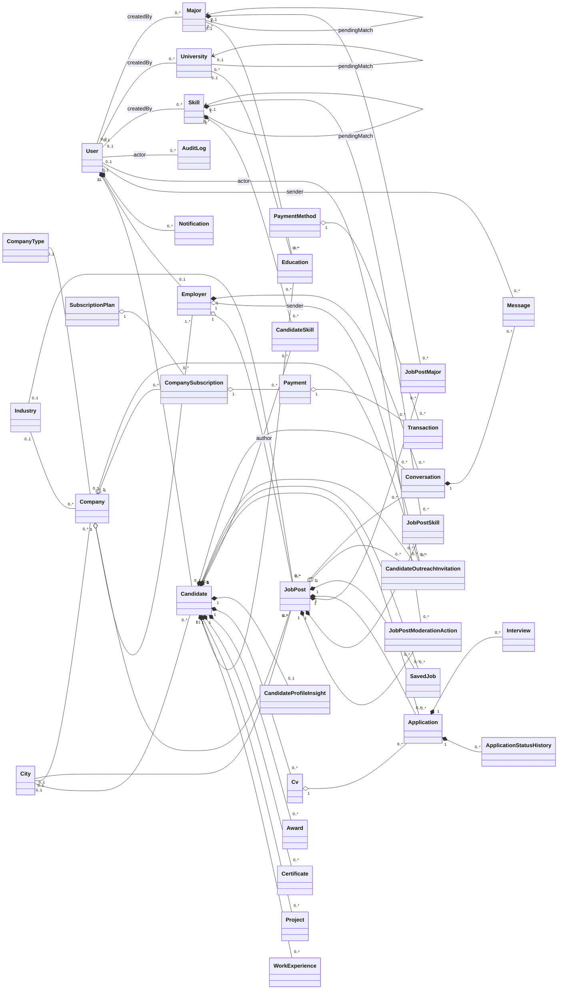
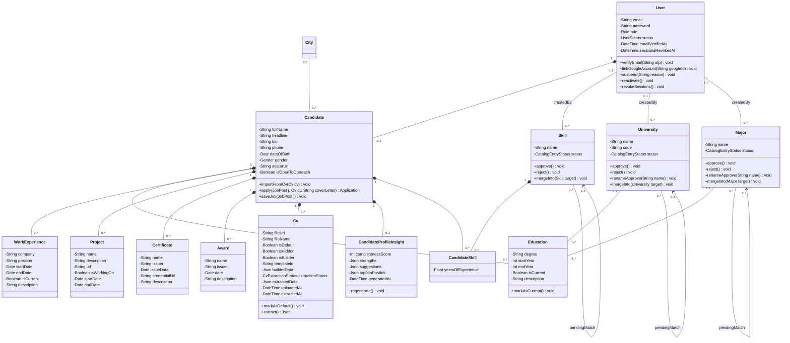
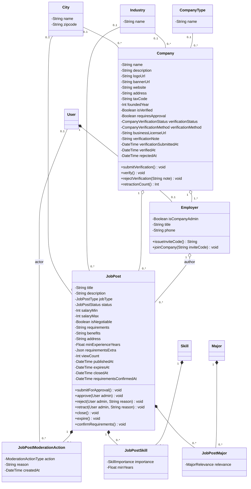
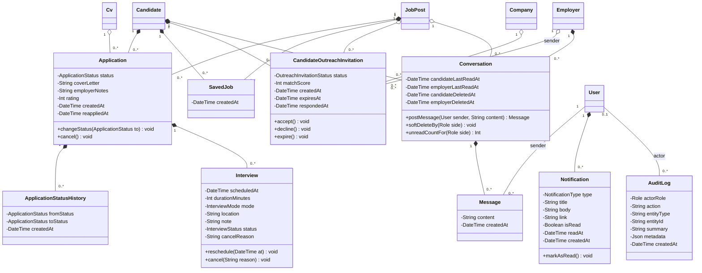
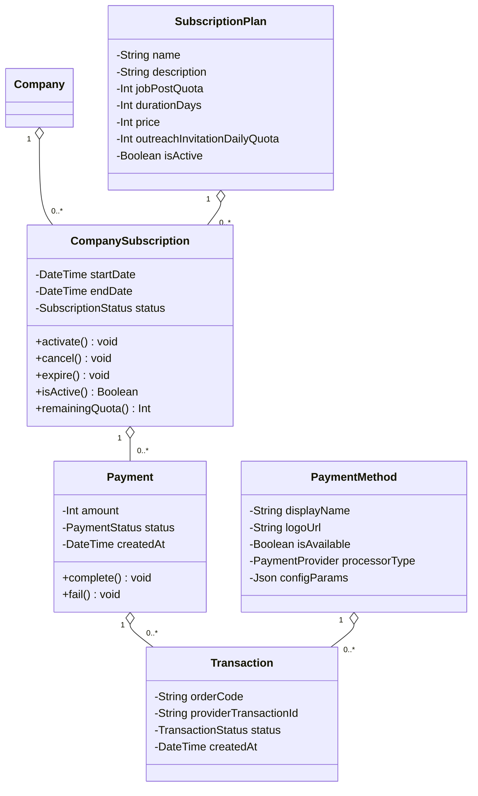

# Class Diagram — Bản tách cho báo cáo

Tách sơ đồ lớp đầy đủ trong `CLASS_DIAGRAM.md` §5.1 thành **1 sơ đồ tổng quan + 4 sơ đồ con** để đưa vào báo cáo. Nội dung (attribute, method, quan hệ, multiplicity) giữ nguyên như `CLASS_DIAGRAM.md`; khi sửa sơ đồ, sửa ở `CLASS_DIAGRAM.md` trước rồi cập nhật lại file này. Quy tắc lọc, bảng invariant của method và quy ước chọn loại quan hệ xem `CLASS_DIAGRAM.md` §2, §3, §6, §7.

**Quy ước tách:**

- Mỗi class được vẽ **đầy đủ attribute và method ở đúng một sơ đồ con** (sơ đồ "nhà" của nó, xem bảng dưới).
- Ở sơ đồ con khác, class đó chỉ xuất hiện dưới dạng **hộp chỉ có tên** để làm điểm nối quan hệ.
- Mỗi quan hệ chỉ vẽ ở **một** sơ đồ con, là sơ đồ chứa class phía "con" (phía `0..*`).
- Sơ đồ tổng quan vẽ đủ 36 class và mọi quan hệ nhưng **không có attribute/method**, giúp người đọc thấy toàn cảnh.

| Sơ đồ | Class vẽ đầy đủ | Class chỉ có tên (định nghĩa ở sơ đồ khác) |
|---|---|---|
| §2 Ứng viên & hồ sơ | `User`, `Candidate`, `Education`, `WorkExperience`, `Project`, `Certificate`, `Award`, `CandidateSkill`, `Cv`, `CandidateProfileInsight`, `Skill`, `University`, `Major` (13) | `City` |
| §3 Doanh nghiệp & tin tuyển dụng | `Company`, `Employer`, `City`, `Industry`, `CompanyType`, `JobPost`, `JobPostSkill`, `JobPostMajor`, `JobPostModerationAction` (9) | `User`, `Skill`, `Major` |
| §4 Ứng tuyển & tương tác | `Application`, `ApplicationStatusHistory`, `Interview`, `SavedJob`, `CandidateOutreachInvitation`, `Conversation`, `Message`, `Notification`, `AuditLog` (9) | `User`, `Candidate`, `Cv`, `JobPost`, `Company`, `Employer` |
| §5 Gói dịch vụ & thanh toán | `SubscriptionPlan`, `CompanySubscription`, `Payment`, `Transaction`, `PaymentMethod` (5) | `Company` |

Tổng: 13 + 9 + 9 + 5 = 36 class, khớp `CLASS_DIAGRAM.md` §4. Enum xem `CLASS_DIAGRAM.md` §5.2.

## 1. Sơ đồ tổng quan

## 2. Ứng viên & hồ sơ

Tài khoản, hồ sơ ứng viên, CV và danh mục dùng cho hồ sơ (kỹ năng, trường, ngành).

## 3. Doanh nghiệp & tin tuyển dụng

Công ty, nhà tuyển dụng, tin tuyển dụng, yêu cầu kỹ năng/ngành của tin và lịch sử kiểm duyệt.

## 4. Ứng tuyển & tương tác

Ứng tuyển, phỏng vấn, lưu tin, mời ứng viên, nhắn tin, thông báo và nhật ký quản trị.

## 5. Gói dịch vụ & thanh toán

Gói dịch vụ, đăng ký gói của công ty và luồng thanh toán.

## 6. Gợi ý khi vẽ lại bằng Visual Paradigm

- Hộp "chỉ có tên" nên ẩn compartment attribute/method (Presentation Options → Show Attributes/Operations), hoặc tô màu nhạt khác hộp chính để người đọc biết class đó được định nghĩa ở sơ đồ khác.
- Dùng đường kiểu Rectilinear và đặt class danh mục (`City`, `Industry`, `CompanyType`) sát class dùng nó, tránh đường chạy vòng ra mép trang.
- Đặt class "cha" (phía có hình thoi) ở trên hoặc bên trái, class "con" ở dưới hoặc bên phải; sơ đồ đọc theo một chiều sẽ ít đường cắt nhau hơn.
- `CandidateSkill`, `JobPostSkill`, `JobPostMajor`, `Application`, `SavedJob` có thể đổi sang ký hiệu association class chuẩn (đường nét đứt gắn vào giữa quan hệ N–N), xem `CLASS_DIAGRAM.md` §7 ghi chú 1.
