# Class Diagram V7 — Thiết kế lại sơ đồ lớp

Tài liệu này dùng để nhóm 68 **tự vẽ lại** sơ đồ lớp trong Visual Paradigm. Nó thay cho cách làm ở `CLASS_DIAGRAM.md` và `CLASS_DIAGRAM_SPLIT.md`, nhưng chưa xoá hai file đó. Hai file cũ vẫn giữ để đối chiếu.

Ngày lập: 2026-11-18.

## 1. Vì sao phải vẽ lại

Nhận xét của cô về bản V6:

| Nhận xét | Nguyên nhân trong bản V6 | Cách sửa ở V7 |
|---|---|---|
| Sơ đồ lớp lai với lược đồ CSDL | Bản V6 chép gần như toàn bộ `schema.prisma` (36 lớp): bảng nối, bảng danh mục, cột kỹ thuật, kiểu `Json` | Chỉ giữ lớp nghiệp vụ. Bảng nối chuyển thành lớp liên kết (association class), danh mục chuyển thành thuộc tính, cột kỹ thuật bỏ (§4, §8) |
| Không rõ là composition hay kế thừa | `User ◆— Candidate`, `User ◆— Employer` vẽ là composition | Dùng **kế thừa**: `User` là lớp trừu tượng, `Candidate`, `Employer`, `Admin` là lớp con (§3) |
| Liên kết bùng nổ, dùng ký hiệu tuỳ tiện | Một lớp là phần của hai lớp tổng thể (`Application` thuộc cả `Candidate ◆` và `JobPost ◆`); `createdBy` vẽ thành composition; aggregation dùng không có lý do | Mặc định dùng association thường. Composition và aggregation chỉ dùng khi thoả quy tắc ở §5.1 |
| Chưa làm thuộc tính dẫn suất | `isVerified` lưu song song với `verificationStatus`; `retractionCount()`, `remainingQuota()` để dạng phương thức | Đánh dấu thuộc tính dẫn suất bằng `/` và ghi công thức tính (§6) |
| Hình không đọc được | Một sơ đồ 36 lớp, đường cắt nhau; lớp bị nhân bản (`User7`, `User8`, `City6`…) | Một sơ đồ tổng chỉ có tên lớp + 4 sơ đồ chi tiết theo gói; không nhân bản lớp (§9) |

Quyết định ở `CLASS_DIAGRAM.md` §1 (bỏ kế thừa vì Prisma không hỗ trợ table inheritance) là **sai hướng**. Sơ đồ lớp mô tả khái niệm nghiệp vụ, không mô tả cách lưu bảng. Cách lưu bảng là bước ánh xạ riêng (§7).

## 2. Hai mức mô hình

| | Sơ đồ lớp (V7) | ERD (`ER_DIAGRAM.md`) |
|---|---|---|
| Mục đích | Mô tả khái niệm nghiệp vụ và trách nhiệm | Mô tả bảng thật trong PostgreSQL |
| Kế thừa | Có (`User` ← `Candidate`, `Employer`, `Admin`) | Không có. Ánh xạ thành bảng cha + bảng con nối 1–1 |
| Bảng nối | Lớp liên kết hoặc association thường | Bảng riêng có khoá chính kép |
| Danh mục (`City`, `Industry`…) | Thuộc tính kiểu `String` | Bảng riêng + khoá ngoại |
| Thuộc tính dẫn suất | Có, ký hiệu `/` | Không lưu (tính lúc truy vấn), trừ trường hợp lưu sẵn để tăng tốc (§6.2) |
| Kiểu `Json`, `vector` | Không dùng | Có (`jsonb`, `vector(384)`) |
| Cột kỹ thuật (`id`, khoá ngoại, `updatedAt`) | Không có | Có |
| Phương thức | Có | Không |

Hai sơ đồ **không cần giống nhau 1:1**.

## 3. Kế thừa User

```
              «abstract» User
                    △
        ┌───────────┼───────────┐
    Candidate    Employer     Admin
           {complete, disjoint}
```

- `{complete}`: mọi tài khoản đều thuộc một trong ba vai trò. Không có tài khoản "chỉ là User".
- `{disjoint}`: một tài khoản chỉ có một vai trò. Trong schema, `User.role` là một giá trị đơn.
- `User` là lớp trừu tượng (tên in nghiêng trong Visual Paradigm), vì không tạo đối tượng `User` trực tiếp.
- Bỏ thuộc tính `role : Role` khỏi `User`. Vai trò đã thể hiện bằng chính lớp con. Thuộc tính `role` chỉ xuất hiện trong ERD làm cột phân biệt (§7).

Lý do không dùng composition: composition nghĩa là "User **chứa** một Candidate như một bộ phận". Thực tế ứng viên **là** người dùng. Câu kiểm tra: "Candidate là một loại User?" → đúng, nên dùng kế thừa.

## 4. Danh sách lớp

19 lớp và 3 lớp liên kết, chia 4 gói.

Ký hiệu: `-` private, `+` public, `/` dẫn suất, `[0..1]` không bắt buộc, `String[]` danh sách chuỗi.

### 4.1 Gói Tài khoản & Hồ sơ ứng viên

**User** «abstract»

| Thuộc tính | Phương thức |
|---|---|
| `-email : String` | `+verifyEmail(otp : String) : void` |
| `-password : String` | `+changePassword(old : String, new : String) : void` |
| `-status : UserStatus` | |
| `-emailVerifiedAt : DateTime [0..1]` | |

**Candidate** (kế thừa User)

| Thuộc tính | Phương thức |
|---|---|
| `-fullName : String` | `+apply(job : JobPost, cv : Cv, coverLetter : String) : Application` |
| `-headline : String [0..1]` | `+saveJob(job : JobPost) : void` |
| `-phone : String [0..1]` | `+importFromCv(cv : Cv) : void` |
| `-dateOfBirth : Date [0..1]` | |
| `-gender : Gender [0..1]` | |
| `-city : String [0..1]` | |
| `-isOpenToOutreach : Boolean` | |

**Employer** (kế thừa User)

| Thuộc tính | Phương thức |
|---|---|
| `-title : String [0..1]` | `+createJobPost(...) : JobPost` |
| `-phone : String [0..1]` | `+inviteCandidate(c : Candidate, job : JobPost) : OutreachInvitation` |
| `-isCompanyAdmin : Boolean` | |

**Admin** (kế thừa User)

| Thuộc tính | Phương thức |
|---|---|
| (không có) | `+suspendUser(u : User, reason : String) : void` |
| | `+reactivateUser(u : User) : void` |
| | `+verifyCompany(c : Company) : void` |
| | `+rejectCompany(c : Company, note : String) : void` |

**Education**

| Thuộc tính | Phương thức |
|---|---|
| `-university : String` | `+markAsCurrent() : void` |
| `-major : String` | |
| `-degree : String [0..1]` | |
| `-startYear : Int [0..1]` | |
| `-endYear : Int [0..1]` | |
| `-isCurrent : Boolean` | |

**Cv**

| Thuộc tính | Phương thức |
|---|---|
| `-fileName : String` | `+markAsDefault() : void` |
| `-fileUrl : String` | `+extract() : void` |
| `-isDefault : Boolean` | |
| `-extractionStatus : CvExtractionStatus` | |
| `-uploadedAt : DateTime` | |

**Skill**

| Thuộc tính | Phương thức |
|---|---|
| `-name : String` | `+approve() : void` |
| `-status : CatalogEntryStatus` | `+mergeInto(target : Skill) : void` |

**CandidateSkill** — lớp liên kết trên đường `Candidate — Skill`

| Thuộc tính | Phương thức |
|---|---|
| `-yearsOfExperience : Float` | `+CandidateSkill(yearsOfExperience : Float)` |

### 4.2 Gói Doanh nghiệp & Gói dịch vụ

**Company**

| Thuộc tính | Phương thức |
|---|---|
| `-name : String` | `+submitVerification(licenseUrl : String) : void` |
| `-taxCode : String [0..1]` | |
| `-address : String [0..1]` | |
| `-website : String [0..1]` | |
| `-industry : String [0..1]` | |
| `-city : String [0..1]` | |
| `-verificationStatus : CompanyVerificationStatus` | |
| `-/isVerified : Boolean` | |
| `-/retractionCount : Int` | |

**SubscriptionPlan**

| Thuộc tính | Phương thức |
|---|---|
| `-name : String` | `+SubscriptionPlan(name : String, price : Int, durationDays : Int, jobPostQuota : Int)` |
| `-price : Int` | |
| `-durationDays : Int` | |
| `-jobPostQuota : Int` | |
| `-dailyInvitationQuota : Int` | |
| `-isActive : Boolean` | |

**CompanySubscription**

| Thuộc tính | Phương thức |
|---|---|
| `-startDate : DateTime` | `+activate() : void` |
| `-endDate : DateTime` | `+cancel() : void` |
| `-status : SubscriptionStatus` | |
| `-/isActive : Boolean` | |
| `-/remainingQuota : Int` | |

**Payment**

| Thuộc tính | Phương thức |
|---|---|
| `-amount : Int` | `+complete(providerTxnId : String) : void` |
| `-provider : PaymentProvider` | `+fail() : void` |
| `-status : PaymentStatus` | |
| `-createdAt : DateTime` | |

`Payment` gộp `Payment`, `Transaction` và `PaymentMethod` của schema. Ở mức khái niệm, "công ty thanh toán gói qua VNPay/MoMo" chỉ cần một lớp. Việc tách thành từng lần gọi cổng thanh toán là quyết định lưu trữ, nằm trong ERD.

### 4.3 Gói Tuyển dụng

**JobPost**

| Thuộc tính | Phương thức |
|---|---|
| `-title : String` | `+submitForApproval() : void` |
| `-description : String` | `+approve(admin : Admin) : void` |
| `-requirements : String [0..1]` | `+reject(admin : Admin, reason : String) : void` |
| `-jobType : JobPostType` | `+close() : void` |
| `-status : JobPostStatus` | `+expire() : void` |
| `-salaryMin : Int [0..1]` | |
| `-salaryMax : Int [0..1]` | |
| `-city : String [0..1]` | |
| `-minExperienceYears : Float [0..1]` | |
| `-hiringTarget : Int` | |
| `-autoOutreachEnabled : Boolean` | |
| `-publishedAt : DateTime [0..1]` | |
| `-expiresAt : DateTime [0..1]` | |
| `-/acceptedCount : Int` | |

**JobPostSkill** — lớp liên kết trên đường `JobPost — Skill`

| Thuộc tính | Phương thức |
|---|---|
| `-importance : SkillImportance` | `+JobPostSkill(importance : SkillImportance, minYears : Float)` |
| `-minYears : Float [0..1]` | |

**Application**

| Thuộc tính | Phương thức |
|---|---|
| `-status : ApplicationStatus` | `+changeStatus(to : ApplicationStatus) : void` |
| `-coverLetter : String [0..1]` | `+cancel() : void` |
| `-rating : Int [0..1]` | |
| `-appliedAt : DateTime` | |

**Interview**

| Thuộc tính | Phương thức |
|---|---|
| `-scheduledAt : DateTime` | `+reschedule(at : DateTime) : void` |
| `-durationMinutes : Int` | `+cancel(reason : String) : void` |
| `-mode : InterviewMode` | |
| `-location : String [0..1]` | |
| `-status : InterviewStatus` | |
| `-/endsAt : DateTime` | |
| `-/isCompleted : Boolean` | |

### 4.4 Gói Gợi ý (AI) & Liên lạc

**MatchScore** — lớp liên kết trên đường `Candidate — JobPost` ("độ phù hợp")

| Thuộc tính | Phương thức |
|---|---|
| `-/score : Int` | `+MatchScore(score : Int)` |
| `-scoredAt : DateTime` | |

**OutreachInvitation**

| Thuộc tính | Phương thức |
|---|---|
| `-status : OutreachInvitationStatus` | `+accept(cv : Cv) : Application` |
| `-source : InvitationSource` | `+decline() : void` |
| `-matchScore : Int [0..1]` | `+expire() : void` |
| `-sentAt : DateTime` | |
| `-expiresAt : DateTime` | |

**CandidateProfileInsight**

| Thuộc tính | Phương thức |
|---|---|
| `-completenessScore : Int` | `+regenerate() : void` |
| `-strengths : String[]` | |
| `-suggestions : String[]` | |
| `-generatedAt : DateTime` | |

**Conversation**

| Thuộc tính | Phương thức |
|---|---|
| `-createdAt : DateTime` | `+postMessage(sender : User, content : String) : Message` |
| | `+unreadCountFor(user : User) : Int` |

**Message**

| Thuộc tính | Phương thức |
|---|---|
| `-content : String` | `+Message(content : String)` |
| `-sentAt : DateTime` | |

**Quy ước constructor:** lớp nào không có nghiệp vụ riêng thì vẽ constructor (`+TênLớp(tham số)`, cùng tên lớp, không có kiểu trả về) để thể hiện cách tạo đối tượng. Áp dụng cho `CandidateSkill`, `JobPostSkill`, `MatchScore`, `SubscriptionPlan`, `Message`. Tham số chỉ gồm các thuộc tính phải nhập khi tạo. Các thuộc tính hệ thống tự gán (`sentAt`, `scoredAt`, `isActive`…) không đưa vào.

**Notification**

| Thuộc tính | Phương thức |
|---|---|
| `-type : NotificationType` | `+markAsRead() : void` |
| `-title : String` | |
| `-body : String [0..1]` | |
| `-isRead : Boolean` | |
| `-createdAt : DateTime` | |

### 4.5 Enum

Vẽ thành hộp `«enumeration»`, không nối đường tới lớp dùng nó: `UserStatus`, `Gender`, `CvExtractionStatus`, `CatalogEntryStatus`, `CompanyVerificationStatus`, `SubscriptionStatus`, `PaymentStatus`, `PaymentProvider`, `JobPostType`, `JobPostStatus`, `SkillImportance`, `ApplicationStatus`, `InterviewMode`, `InterviewStatus`, `OutreachInvitationStatus`, `InvitationSource`, `NotificationType`.

Giá trị lấy đúng theo `schema.prisma`. `NotificationType` có hơn 20 giá trị, có thể chỉ ghi vài giá trị tiêu biểu kèm `...`.

## 5. Quan hệ

### 5.1 Quy tắc chọn loại quan hệ

1. **Kế thừa (generalization)**: chỉ khi câu "A là một loại B" đúng.
2. **Composition (◆)**: chỉ khi thoả **cả ba** điều kiện:
   - phần chỉ thuộc **đúng một** tổng thể,
   - phần không tồn tại khi không có tổng thể,
   - xoá tổng thể thì xoá luôn phần (trong schema có `onDelete: Cascade` từ phần về tổng thể).
3. **Aggregation (◇)**: quan hệ "gồm có", nhưng phần vẫn tồn tại độc lập. Dùng hạn chế.
4. **Association (—)**: mọi trường hợp còn lại. Đây là lựa chọn mặc định.
5. **Lớp liên kết (association class)**: khi chính mối liên kết có thuộc tính riêng và mỗi cặp đối tượng chỉ có một liên kết.

### 5.2 Bảng quan hệ

| # | Lớp A | Bội số A | Loại | Bội số B | Lớp B | Tên / vai trò | Lý do chọn |
|---|---|---|---|---|---|---|---|
| 1 | User | | Kế thừa | | Candidate, Employer, Admin | `{complete, disjoint}` | §3 |
| 2 | Candidate | 1 | Composition | 0..* | Education | | Học vấn chỉ thuộc một ứng viên, xoá ứng viên thì xoá theo (Cascade) |
| 3 | Candidate | 1 | Composition | 0..* | Cv | | CV chỉ thuộc một ứng viên, xoá theo (Cascade) |
| 4 | Candidate | 1 | Composition | 0..1 | CandidateProfileInsight | | Kết quả phân tích của riêng một hồ sơ, xoá theo (Cascade) |
| 5 | Candidate | 0..* | Association + lớp liên kết `CandidateSkill` | 0..* | Skill | có kỹ năng | Skill là danh mục dùng chung, không thuộc riêng ai. Số năm kinh nghiệm là thuộc tính của cặp |
| 6 | Company | 1 | Aggregation | 1..* | Employer | gồm | Công ty gồm các nhà tuyển dụng, nhưng tài khoản nhà tuyển dụng không bị xoá theo công ty (schema không Cascade) |
| 7 | Employer | 1 | Association | 0..* | JobPost | đăng | Người đăng tin |
| 8 | Company | 1 | Association | 0..* | JobPost | sở hữu | Ràng buộc: `{job.company = job.employer.company}` |
| 9 | JobPost | 0..* | Association + lớp liên kết `JobPostSkill` | 0..* | Skill | yêu cầu | Mức độ quan trọng và số năm tối thiểu là thuộc tính của cặp |
| 10 | Company | 1 | Association | 0..* | CompanySubscription | đăng ký | Lịch sử đăng ký gói cần giữ lại để đối soát; không xoá theo |
| 11 | SubscriptionPlan | 1 | Association | 0..* | CompanySubscription | theo gói | Gói là danh mục dùng chung |
| 12 | CompanySubscription | 1 | Association | 0..* | Payment | thanh toán cho | Thanh toán là chứng từ, giữ lại độc lập |
| 13 | Candidate | 1 | Association | 0..* | Application | nộp | Không dùng composition: `Application` liên quan cả Candidate và JobPost, không thể là phần của hai tổng thể |
| 14 | JobPost | 1 | Association | 0..* | Application | nhận | Như dòng 13. Ràng buộc: `{mỗi cặp (candidate, job) chỉ có một đơn}` |
| 15 | Application | 0..* | Association | 1 | Cv | đính kèm | CV dùng lại cho nhiều đơn |
| 16 | Application | 1 | Composition | 0..* | Interview | | Lịch phỏng vấn chỉ thuộc một đơn, xoá theo (Cascade) |
| 17 | Candidate | 0..* | Association | 0..* | JobPost | lưu | Tin đã lưu. Không có thuộc tính riêng nên không cần lớp `SavedJob` |
| 18 | Candidate | 0..* | Association + lớp liên kết `MatchScore` | 0..* | JobPost | độ phù hợp | Điểm phù hợp là thuộc tính của cặp ứng viên–tin |
| 19 | Employer | 1 | Association | 0..* | OutreachInvitation | gửi | |
| 20 | Candidate | 1 | Association | 0..* | OutreachInvitation | nhận | |
| 21 | JobPost | 1 | Association | 0..* | OutreachInvitation | cho tin | |
| 22 | OutreachInvitation | 0..1 | Association | 0..1 | Application | tạo ra | Nhận lời mời = ứng tuyển (AD-28) |
| 23 | Candidate | 1 | Association | 0..* | Conversation | tham gia | |
| 24 | Employer | 1 | Association | 0..* | Conversation | tham gia | |
| 25 | JobPost | 1 | Association | 0..* | Conversation | về tin | |
| 26 | Conversation | 1 | Composition | 0..* | Message | | Tin nhắn chỉ thuộc một hội thoại, xoá theo (Cascade) |
| 27 | Message | 0..* | Association | 1 | User | người gửi | |
| 28 | User | 1 | Composition | 0..* | Notification | | Thông báo chỉ thuộc một người, xoá theo (Cascade) |

Tổng: 1 nhóm kế thừa, 6 composition, 1 aggregation, 20 association (3 trong số đó có lớp liên kết).

Các quan hệ **cố ý không vẽ**: `createdBy` (User–Skill), `pendingMatch` (Skill–Skill), quan hệ "đã duyệt bởi" giữa Admin và JobPost. Đây là dữ liệu phục vụ vận hành và kiểm tra, không phải khái niệm chính. Việc Admin duyệt tin đã thể hiện qua tham số `admin` của `JobPost.approve()`.

## 6. Thuộc tính dẫn suất

### 6.1 Không lưu — tính khi đọc

| Thuộc tính | Công thức | Trong CSDL |
|---|---|---|
| `Company./isVerified` | `verificationStatus = VERIFIED` | Hiện đang có cột `isVerified` lưu song song (giữ vì lý do tương thích). Trong sơ đồ lớp vẫn ghi là dẫn suất |
| `Company./retractionCount` | Số lần tin của công ty bị rút duyệt (hành động `RETRACTED` trong lịch sử kiểm duyệt) | Không có cột, đếm lúc truy vấn |
| `CompanySubscription./isActive` | `status = ACTIVE` và `startDate ≤ hôm nay < endDate` | Không có cột |
| `CompanySubscription./remainingQuota` | `plan.jobPostQuota` − số tin công ty tạo trong khoảng `[startDate, endDate)` | Không có cột, đếm lúc truy vấn |
| `JobPost./acceptedCount` | Số `Application` của tin có `status = ACCEPTED` | Không có cột. Dùng để dừng tự mời khi `acceptedCount ≥ hiringTarget` |
| `Interview./endsAt` | `scheduledAt + durationMinutes` | Không có cột |
| `Interview./isCompleted` | `status = SCHEDULED` và `endsAt < hiện tại` | Không có cột (schema ghi rõ: "Đã diễn ra" suy ra từ `scheduledAt`, không lưu `COMPLETED`) |

Cách ghi trong Visual Paradigm: chọn thuộc tính → *Open Specification* → đánh dấu *Derived*. Tên sẽ hiện dấu `/`. Ghi công thức vào ô *Default value* hoặc gắn một *note* dạng `{isVerified = verificationStatus = VERIFIED}`.

### 6.2 Dẫn suất nhưng lưu sẵn

`MatchScore./score` được tính từ hồ sơ ứng viên, yêu cầu của tin và độ tương đồng ngữ nghĩa. Về mặt khái niệm đây là thuộc tính dẫn suất. Nhưng tính lại mỗi lần đọc quá chậm, nên hệ thống **lưu sẵn** trong bảng `job_candidate_match_scores` và chấm lại theo lịch.

Khi chuyển sang ERD, thuộc tính này trở thành **cột thường** (`score INT`), kèm cột `scoredAt` để biết điểm được tính lúc nào. Đây là cách xử lý khi muốn lưu thuộc tính dẫn suất: chuyển thành thuộc tính thường và chấp nhận phải cập nhật lại khi dữ liệu nguồn thay đổi.

## 7. Ánh xạ sang CSDL (sơ đồ lớp → ERD)

| Trong sơ đồ lớp | Trong CSDL hiện tại |
|---|---|
| Kế thừa `User` ← `Candidate`, `Employer`, `Admin` | Chiến lược *class table inheritance*: bảng `users` (cha); `candidates`, `employers` (con) có `userId` duy nhất trỏ về `users`, `onDelete: Cascade`. Cột `users.role` phân biệt vai trò. `Admin` không có thuộc tính riêng nên không cần bảng |
| Lớp liên kết `CandidateSkill`, `JobPostSkill`, `MatchScore` | Bảng `candidate_skills`, `job_post_skills`, `job_candidate_match_scores`, khoá chính kép |
| Association n–n "lưu" | Bảng `saved_jobs` |
| Thuộc tính `city`, `industry`, `university`, `major` | Bảng danh mục `cities`, `industries`, `universities`, `majors` + khoá ngoại |
| `Payment` | Ba bảng `payments`, `transactions`, `payment_methods` (tách để giữ lịch sử mỗi lần gọi cổng thanh toán) |
| `String[]` (`strengths`, `suggestions`) | Cột `jsonb` |
| Composition | Khoá ngoại có `onDelete: Cascade` |

**Không cần đổi kiến trúc hay schema.** Schema hiện tại đã là một cách ánh xạ hợp lệ cho sơ đồ lớp V7. Trong báo cáo chỉ cần thêm một đoạn nêu chiến lược ánh xạ kế thừa.

## 8. Lớp có trong schema nhưng không vẽ

| Model trong schema | Xử lý |
|---|---|
| `City`, `Industry`, `CompanyType`, `University`, `Major` | Thành thuộc tính `String` |
| `SkillAlias`, `UniversityAlias`, `MajorAlias` | Bỏ. Chức năng gộp thể hiện qua `Skill.mergeInto()` |
| `SavedJob` | Thành association n–n (dòng 17) |
| `WorkExperience`, `Project`, `Certificate`, `Award` | Bỏ khỏi sơ đồ tổng. Có thể vẽ thêm trong sơ đồ chi tiết gói Hồ sơ, cùng kiểu composition như `Education` |
| `Transaction`, `PaymentMethod`, `PaymentCallbackLog` | Gộp vào `Payment` |
| `JobPostMajor` | Bỏ khỏi sơ đồ tổng. Nếu cần, vẽ như `JobPostSkill` trong sơ đồ chi tiết |
| `JobPostModerationAction`, `ApplicationStatusHistory`, `AuditLog`, `AuditLogArchive`, `AuditLogHourlyStat` | Bỏ. Đây là nhật ký, chỉ có trong ERD |
| `CandidateEmbedding`, `JobPostEmbedding` | Bỏ. Vector là chi tiết cài đặt của phần chấm điểm |
| `JobAlert`, `JobPostDailyStat`, `OutboxEvent`, `JobReport` | Bỏ. Phục vụ vận hành hoặc tính năng phụ |

Thuộc tính `Json` không đưa vào sơ đồ lớp: `builderData`, `extractedData`, `rawResponse`, `configParams`, `metadata`, `topJobPostIds`, `requirementsExtra`. Riêng `strengths` và `suggestions` có ý nghĩa nghiệp vụ nên ghi kiểu `String[]`.

## 9. Bố cục khi vẽ

Một sơ đồ tổng và 4 sơ đồ chi tiết.

| Sơ đồ | Nội dung |
|---|---|
| Tổng quan | 19 lớp + 3 lớp liên kết, **chỉ có tên lớp**, đủ 28 quan hệ ở §5.2 |
| Chi tiết 1 — Tài khoản & Hồ sơ | `User`, `Candidate`, `Employer`, `Admin`, `Education`, `Cv`, `Skill`, `CandidateSkill`, `CandidateProfileInsight` |
| Chi tiết 2 — Doanh nghiệp & Gói dịch vụ | `Company`, `Employer`, `SubscriptionPlan`, `CompanySubscription`, `Payment` |
| Chi tiết 3 — Tuyển dụng | `JobPost`, `JobPostSkill`, `Skill`, `Application`, `Interview`, `Cv`, `Candidate`, `Employer`, `Company` |
| Chi tiết 4 — Gợi ý & Liên lạc | `MatchScore`, `OutreachInvitation`, `Conversation`, `Message`, `Notification`, `Candidate`, `JobPost`, `Employer`, `User` |

Lưu ý khi vẽ trong Visual Paradigm:

1. **Không tạo lớp mới cho mỗi sơ đồ.** Tạo lớp một lần, sau đó ở sơ đồ khác thì kéo lớp từ *Model Explorer* vào. Nếu tạo mới, Visual Paradigm sẽ đặt tên `User7`, `User8`… và các sơ đồ không còn liên kết với nhau.
2. Ở sơ đồ chi tiết, lớp thuộc gói khác có thể ẩn thuộc tính và phương thức (chuột phải → *Presentation Options* → *Hide all attributes/operations*).
3. Lớp liên kết: vẽ association giữa hai lớp trước, sau đó dùng công cụ *Association Class* nối lớp liên kết vào đường đó (đường nét đứt).
4. Kế thừa: vẽ ba đường generalization từ lớp con về `User`, chọn *Generalization Set* để gộp thành một đầu tam giác và ghi `{complete, disjoint}`.
5. Đặt lớp tổng thể ở trên, lớp phần ở dưới để hạn chế đường cắt nhau. Dùng đường gấp khúc (*Rectilinear*).
6. Xuất ảnh: *Export → Active Diagram as Image*, chọn PNG với độ phân giải cao (300 DPI) hoặc SVG. Kiểm tra lại bằng cách phóng to ảnh trong Word: chữ thuộc tính phải đọc được.

## 10. Sơ đồ tổng (bản tham khảo, Mermaid)

Dùng để kiểm tra nhanh trước khi vẽ trong Visual Paradigm. Mermaid không vẽ được lớp liên kết đúng chuẩn UML, nên lớp liên kết được nối bằng nét đứt (`..`).

```mermaid
classDiagram
direction TB

class User {
  <<abstract>>
}
User <|-- Candidate
User <|-- Employer
User <|-- Admin

Candidate "1" *-- "0..*" Education
Candidate "1" *-- "0..*" Cv
Candidate "1" *-- "0..1" CandidateProfileInsight
Candidate "0..*" -- "0..*" Skill : có kỹ năng
CandidateSkill .. Candidate
CandidateSkill .. Skill

Company "1" o-- "1..*" Employer : gồm
Employer "1" -- "0..*" JobPost : đăng
Company "1" -- "0..*" JobPost : sở hữu
JobPost "0..*" -- "0..*" Skill : yêu cầu
JobPostSkill .. JobPost
JobPostSkill .. Skill

Company "1" -- "0..*" CompanySubscription : đăng ký
SubscriptionPlan "1" -- "0..*" CompanySubscription
CompanySubscription "1" -- "0..*" Payment

Candidate "1" -- "0..*" Application : nộp
JobPost "1" -- "0..*" Application : nhận
Application "0..*" -- "1" Cv : đính kèm
Application "1" *-- "0..*" Interview
Candidate "0..*" -- "0..*" JobPost : lưu
Candidate "0..*" -- "0..*" JobPost : độ phù hợp
MatchScore .. Candidate
MatchScore .. JobPost

Employer "1" -- "0..*" OutreachInvitation : gửi
Candidate "1" -- "0..*" OutreachInvitation : nhận
JobPost "1" -- "0..*" OutreachInvitation
OutreachInvitation "0..1" -- "0..1" Application : tạo ra

Candidate "1" -- "0..*" Conversation
Employer "1" -- "0..*" Conversation
JobPost "1" -- "0..*" Conversation
Conversation "1" *-- "0..*" Message
Message "0..*" -- "1" User : người gửi
User "1" *-- "0..*" Notification
```



## 11. Việc nhóm cần tự làm thêm

- Đối chiếu với sơ đồ lớp trong các bài báo cô gửi lên group lớn. Ghi lại 2–3 bài đã tham khảo và điểm nhóm học theo, ví dụ cách vẽ kế thừa người dùng, số lượng lớp, cách tách gói.
- Viết đoạn mô tả sơ đồ trong báo cáo bằng lời của nhóm: mỗi gói vài câu, giải thích các quyết định khó (kế thừa User, vì sao `Application` không phải composition, thuộc tính dẫn suất). Không liệt kê lại từng thuộc tính.
- Cập nhật `ER_DIAGRAM.md` §3 (ánh xạ từ sơ đồ lớp sang ERD) cho khớp §7 của tài liệu này.
